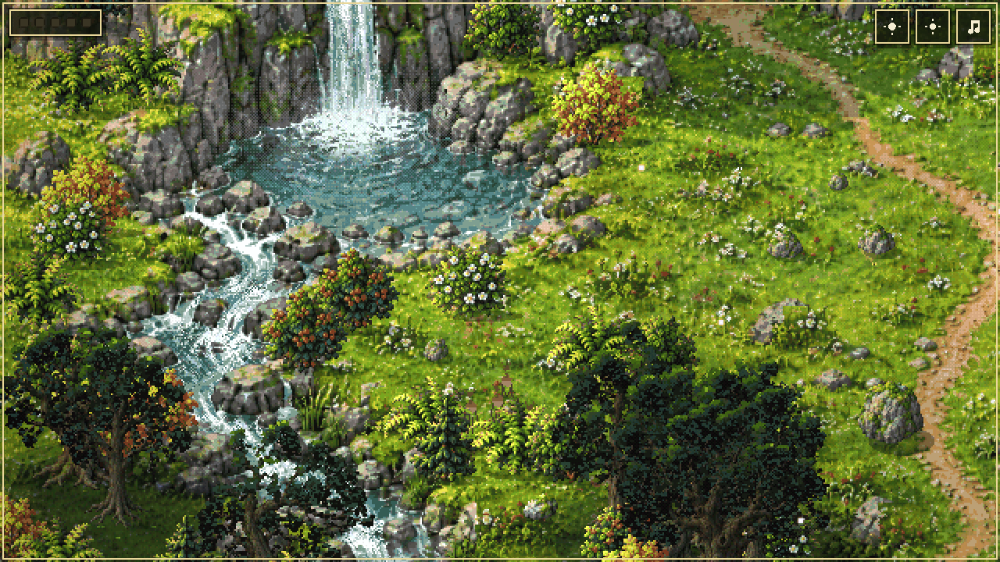
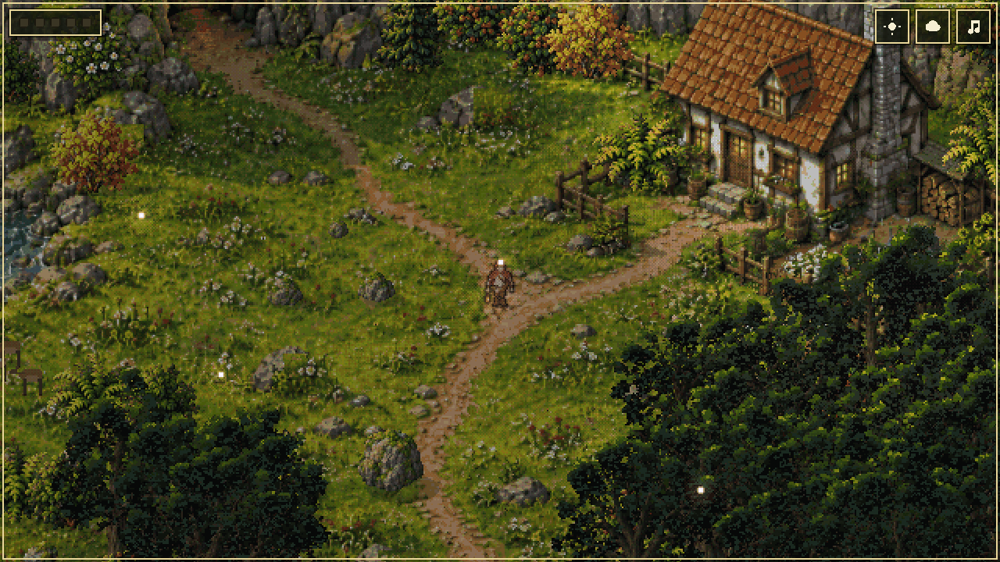
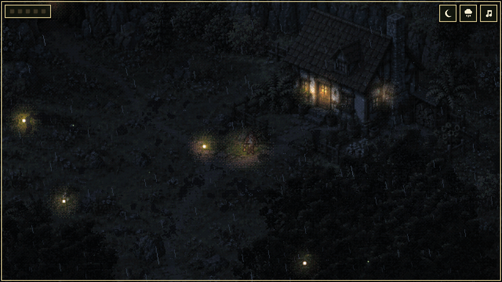
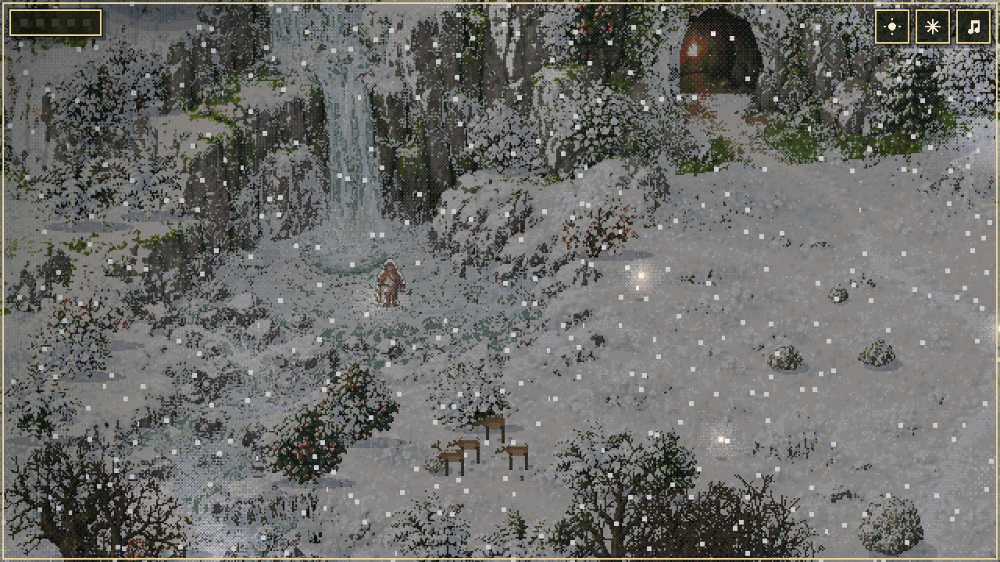
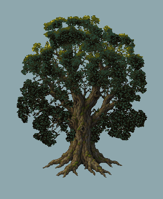

# Heart of the Light

A small glade in dense pixel art. A wanderer with a lantern walks the meadow between a waterfall,
a cottage and a dark cave, gathers the five lights that hover there, and carries them into the
cave: the heart of the light. The glade lives round them: the day passes, six kinds of weather
come and go, the trees sway and shed their leaves, a herd of deer grazes by the stream and takes
flight through it.

## Play it

The demo can be playtested here:

- **minigames.world:** https://minigames.world/play/heart-of-the-light
- **itch.io:** https://legofighter.itch.io/heart-of-the-light

Or locally: `npm install`, then `npm run dev` serves it on http://127.0.0.1:8796 (`npm run build`
writes a static export to `out/`).

## Pictures

| | |
| --- | --- |
|  |  |
|  |  |

The tree is grown in code on a painted bare trunk and swayed in the glade's wind (`lib/tree.ts`;
`/tree` in the dev app shows one on its own: ArrowUp/Down for the wind, R for another tree).
Every tree of the glade moves the same way (0.4.2).

## Licence

MIT (`LICENSE`): free to use, change and pass on, also commercially. A mention of
**LegoFighter** would be nice. The fonts and libraries keep their own licences
(`public/licenses.txt`). This repository is a copy of the game out of a private monorepo; the
notes in `AGENTS.md` are the working notes from there, kept as they were. No copy of the game
from here sends anything anywhere: there is no tracking in it.

## Playing

- Arrow keys or WASD walk; or hold a finger or the mouse where the wanderer should go.
- H says where the nearest light (or, once all are gathered, the cave) is and how far; R says the
  last line again; M turns the music off and on.
- T moves the time on three hours, Y brings the next weather (the two buttons at the top do the
  same). A day passes in six minutes; the weather changes every minute or two.
- Pins for pictures and tests: `?hour=22&weather=storm`, `?at=560,300` (where the wanderer starts),
  `?zoom=1` (the whole glade, one to one).

## How it is made

- **The glade** is one painting (`public/assets/scene.png`, 1024x576, 96 colours) that moves in a
  WebGL2 shader (`lib/stage.ts`) by taking other pixels of itself: painted leaves and grass sway
  and flicker by whole pixels (no gust rolls across them as a wave since 0.4.2), the falls and
  the stream run along a flow map with a dithered two-phase crossfade, the pool rings, mist
  rises, smoke is drawn in dithered steps. Masks say what is what (`masks.png`, `flow.png`).
- **The day and the weather** (`game/sky.ts`, `game/weather.ts`; the weather changes every
  minute or so, a change asked for with the button comes in seconds, and snow switched off
  there stops at once and melts in seconds) grade the picture: dawn, day,
  golden hour, dusk and a blue night in which the lights give back the painted colours; clear,
  clouds, rain (1-pixel streaks, splashes, rings on water, wet ground), storm (lightning and
  thunder, rain in drifting sheets, puddles on the path and in the meadow's hollows that mirror
  what stands over them and dry up, stones that shine wet), mist and snow (flakes, and snow that lies and melts: on the meadow and the
  field between the trees, as caps on fences, barrels, stones and the roof; it gives the night's
  and the lantern's light back; clumps fall from the branches in a gust, the eave drips in a
  thaw, the wanderer's footprints are dents in it (a ground canvas the shader reads where the
  snow lies) that fill in again; as it lies the falls freeze from their edges in
  icicles and the pool and the stream from the shore, the roar quietens, and the wanderer's
  breath shows). The sun has its place: rays through the crowns and mist along the stream at
  dawn, a rim of light on the crowns' west edges at golden hour, moonlight in slow patches on the
  open ground at night, the cottage's windows and door lit from dusk (and by day in a storm), and
  the wanderer's shadow swinging from the morning's left to the evening's right.
- **The glade's others** (`lib/view.ts`), there from the start whatever the hour: a deer at the
  forest's edge, a rig in code (`lib/deer.ts`: legs, neck and head on joints, posed by its gait)
  that grazes, strolls along the edge at a walk, bolts into the trees at a gallop when the
  wanderer comes near, away from them, and comes back later; it stands behind the crowns that
  are in front of it (a behind canvas the shader lays under them),
  birds that burst from a crown walked up to and others crossing the glade, a fish in the pool
  (not under ice), a beetle on the stump (not under snow); the grass gives way round the
  wanderer's feet.
- **One palette:** the painting's own colours with the generator's yellow cast taken off, under
  every light of the day and the lantern and the snow, in a look-up cube the shader puts every
  finished pixel through (`lib/palette.ts`), so grass is green, plaster white and the night blue,
  and every effect sits in the same colours.
- **Pure pixels:** every pixel on screen is the same size. Everything is drawn on the glade's
  1024x576 grid at whole pixels, the glade is shown at a whole number of screen pixels per pixel
  (about 1.4 times what covers the window, rounded), and the camera glides in whole screen pixels,
  aiming at the pixel the wanderer is drawn on, so the glide is smooth and the wanderer stands
  still on screen while it follows (`lib/camera.ts`).
- **The wanderer** is a cut-out puppet (`lib/puppet.ts`): pieces on one atlas
  (`hero-parts.png`, `hero-rig.json`), posed 15 times a second, drawn four times the size and
  pressed into a 30-pixel sprite (each pixel the colour that covers most of its block, the edge a
  shade darker), in the glade's own colours (each atlas colour toned down and snapped to the
  painting's palette), its far side from the lantern a step in shade. The lantern swings as a pendulum; the cloak's back flap takes the wind.
- **The sound** (`lib/sound.ts`) is made in code: a dulcimer playing its own phrases in C minor
  over a drone, the waterfall louder as you near it (and quieter under ice), wind, the trees'
  creak in a strong wind, rain, thunder, the ice cracking, birds by day, crickets by night, steps
  that change with the ground (grass, the path, lying snow), and a hum from the nearest light,
  panned to its side.

- **The trees** (0.4.0): every one of the 56 trees stands on a painted bare trunk of its own
  (`public/assets/trunks.png`, from 14 OpenAI sheets through `tools/art/trunks.py`), with twigs
  and leaves grown on it by `lib/tree.ts` (leaves set along the picture's twigs and out of its
  tips, lit where they lie free towards the sun, dark inside the crown and lower down). Since
  0.4.2 they move as the study's tree does: posed fifteen times a second, the twigs bending and
  carrying their leaves, the leaves fluttering in a gust, drawn into a pixel buffer each
  (`TreeSprite`), and only while the camera sees them. They shed their leaves as the snow settles
  and leaf again as it melts; the crowns shade the grass under them. `/tree` in the dev app shows
  one such tree alone, big, from the first study.

## The pictures

From OpenAI (`OPENAI_API_KEY` in the root `.env`), with Pillow, numpy and scipy:

1. `tools/art/openai.py` draws into `tools/art/raw` (not checked in): `scene.png` from
   `scene.txt`; `scene-nosmoke.png` with `smoke.txt` and a mask (the painted smoke out, as the
   game draws its own); `parts-front.png`, `parts-side.png`, `parts-back.png` from the
   `parts-*.txt` prompts, with the first hero sheet (`hero.txt`) as the reference.
2. Since 0.2.0 the glade is a ground with no plants and the trees, bushes and rocks are objects
   on it: `tools/art/exp/ground.txt` (the painting edited with every plant taken out) and the
   sheets `conifers.txt`, `broadleaf.txt`, `bushes.txt`, `rocks.txt` on magenta, all drawn into
   `tools/art/exp` (the pictures are not checked in, the prompts are). `tools/art/flora.py`
   makes `scene.png` (the ground), `flora.png` and `flora.json` (the sprites, where each stands,
   a rock object over every rock painted on the meadow). `tools/art/process.py` is the old way,
   from the first painting.
3. `tools/art/parts.py [PREVIEW_DIR]` makes the atlas and the rig.
4. `tools/art/masks.py [CHECK.png]` makes the masks; `tools/art/overlay.py OUT.png` draws
   `game/world.ts` (where feet may go, the lights, the places) over the scene.

## The animals

`lib/fauna.ts` (0.3.0): a herd of deer by the stream that looks up, flees together (through the
stream and up the far bank, or off the picture) and comes back; rabbits that hide behind a bush;
a fox at dusk and dawn; a heron at the pool at dawn; a squirrel on a trunk; an owl at night;
ducks in the rain. A deer wades, it does not walk on the water (0.4.1): its legs go in under
the waterline the deeper the further from the shore, the water slows it, it kicks up droplets
that fall back and lie as foam, and a bow wave runs with it; where the falls plunge in, the
basin boils with foam that races out along the rings. All of them are sorted by their feet among the plants, and they go round
trunks and rocks. `node tools/debug-fauna.mjs` (with the dev server; `QUERY`, `KEY`, `N`, `OUT`)
prints the herd's state and takes a picture.

## Checks

`npx tsc --noEmit -p .` and `npm test` (the glade's paths and lights, walking, the puppet and its
filter, the day and the weather, the camera's whole device pixels, the palette and its cube). There are no e2e tests yet.

## Still to do

- Blind play checked against `docs/neues-spiel.md`, with its tests; e2e tests. Until then it is
  on minigames.world as a demo, not on `/accessible-games`.

The cover for minigames.world: `node tools/promo/cover.mjs` with the dev server running writes
`tools/promo/cover.png` (golden hour, two screen pixels per pixel), saved as
`apps/web/public/covers/heart-of-the-light.jpg`.
